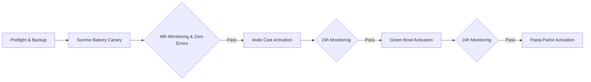

# CMS V3 Production Canary Rollout Plan

> [!IMPORTANT]
> This document defines the operational plan and gates for production cutover. It is a preparation document only and DOES NOT authorize or execute production activation.

## 1. Rollout Strategy & Canary Sequence
Rollout will proceed one store at a time with a mandatory 48-hour monitoring window between activations.



## 2. Activation Commands (Guarded by Tooling)
```bash
# Target Store Production Activation (Requires production credentials & explicit flag)
node backend/scripts/enable_cms_v3_store.js --store=sunrise-bakery --environment=production

# Instant Rollback Command (Immediate fallback to legacy CMS V2)
node backend/scripts/enable_cms_v3_store.js --store=sunrise-bakery --environment=production --disable
```

## 3. Approval Gates
1. **Pre-Deployment**: Full database backup created and verified.
2. **Phase 1 (Canary)**: Activate `sunrise-bakery` only. Verify HTTP 200 on all routes.
3. **Phase 2 (Phase In)**: Activate `arabicast`.
4. **Phase 3 (Expansion)**: Activate `green-bowl` and `pasta-parlor`.

## 4. Rollback Triggers
- Any 5xx server error rate exceeding 0.1% of requests.
- Any reported checkout or cart failure.
- Any cross-tenant data leakage alert.
- Any broken payment or reservation webhook.
