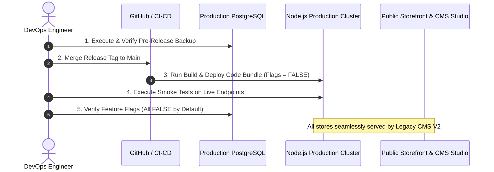

# CMS V3 Production Release Gate & Governance Report

> [!IMPORTANT]
> This document defines the strict release gates, verification procedures, and governance boundaries required prior to and during any production cutover. 
> 
> **Zero production writes or flag activations have been performed.**

---

## 1. Required Fresh Production Backup

Prior to executing any production rollout or schema migration:
1. **Command**:
   ```bash
   node backend/scripts/create_backup.js
   ```
2. **Verification Requirements**:
   - Backup file must be saved in `backend/backups/smartstore_ai_backup_<timestamp>.sql`.
   - File size must be non-zero and verified (baseline ~608 KB).
   - SQL header and table integrity must be validated against all 84 public database tables.
   - Backup file must be replicated to immutable offsite cloud storage before release execution.

---

## 2. Restore Verification Procedure

To test backup viability without mutating the active database:
1. Spin up an isolated ephemeral PostgreSQL container / database (`smartstore_ai_restore_test`).
2. Execute restore command:
   ```bash
   psql -h <host> -U <user> -d smartstore_ai_restore_test -f backend/backups/smartstore_ai_backup_<timestamp>.sql
   ```
3. Run automated verification:
   ```bash
   node backend/scripts/verify_migration_state.js --db=smartstore_ai_restore_test
   ```
4. Confirm 100% row count parity across all commerce and legacy tables before proceeding.

---

## 3. Production Smoke Tests

Immediately following deployment (with all feature flags disabled):
1. **Public Health Check**:
   - `GET /health` -> HTTP 200 `{ status: "ok" }`
2. **Legacy Storefront Preservation**:
   - `GET /api/public/v3/resolve/sunrise-bakery` -> HTTP 200
   - `GET /api/public/v3/resolve/arabicast` -> HTTP 200 `{ v3Enabled: false, fallback: true }`
   - `GET /api/public/v3/resolve/green-bowl` -> HTTP 200 `{ v3Enabled: false, fallback: true }`
   - `GET /api/public/v3/resolve/pasta-parlor` -> HTTP 200 `{ v3Enabled: false, fallback: true }`
3. **Commerce Critical Path**:
   - Fetch product catalog (`GET /api/public/stores/:storeId/products`)
   - Validate discount code API (`POST /api/public/stores/:slug/discounts/validate`)
   - Verify cart drawer initialization and checkout form validation
4. **Owner Studio Authentication**:
   - Log into `/cms-v3` with owner credentials
   - Verify `/cms-v3/website/pages` loads without errors

---

## 4. Deployment Sequence with All Flags Disabled



---

## 5. Production Canary Approval Gates

| Gate | Target Scope | Prerequisites | Monitoring Period | Approver |
|---|---|---|:---:|---|
| **Gate 0: Code Deploy** | Global Infrastructure | Backup verified, tests passing, all flags FALSE | Instant | Lead DevOps Architect |
| **Gate 1: Canary 1** | `sunrise-bakery` (Single Store) | Owner consent, smoke tests passed | **48 Hours** | Store Owner + Principal Architect |
| **Gate 2: Canary 2** | `arabicast` (Single Store) | Gate 1 zero-error signoff, owner consent | **24 Hours** | Store Owner |
| **Gate 3: General Rollout** | `green-bowl`, `pasta-parlor` | Gate 2 zero-error signoff, owner consent | **24 Hours** | Store Owners |

---

## 6. Real-Time Monitoring Requirements

During every canary window, the following real-time metrics must be observed:
- **Error Rates**: 5xx HTTP response rate must remain `< 0.05%`.
- **Latency (P95)**: Public page resolution `< 150ms`.
- **Commerce Safety**: 0 dropped cart sessions, 0 checkout payment gateway failures.
- **Database Connection Pool**: Active pool usage `< 40%` capacity.

---

## 7. Rollback Triggers & Immediate Response

### Triggers:
1. Any 5xx server error spike exceeding 0.1% of requests.
2. Any reported payment or checkout regression.
3. Any cross-tenant data exposure alert.
4. Any data corruption or unhandled AST rendering crash.

### Instant Rollback Command:
```bash
# Instantly disables V3 for target store and routes all traffic to legacy CMS V2 (< 5 seconds)
node backend/scripts/enable_cms_v3_store.js --store=<target-store-slug> --environment=production --disable
```

---

## 8. Exact Owner Approvals Still Required

The following explicit authorizations are required before any production mutation:
- [ ] **Lead DevOps / System Architect**: Authorization to run production migration & code deploy.
- [ ] **Sunrise Bakery Store Owner**: Explicit signoff to activate Gate 1 (`sunrise-bakery` canary).
- [ ] **Arabi Cast Store Owner**: Explicit signoff to activate Gate 2 (`arabicast`).
- [ ] **Green Bowl Store Owner**: Explicit signoff to activate Gate 3 (`green-bowl`).
- [ ] **Pasta Parlor Store Owner**: Explicit signoff to activate Gate 3 (`pasta-parlor`).
