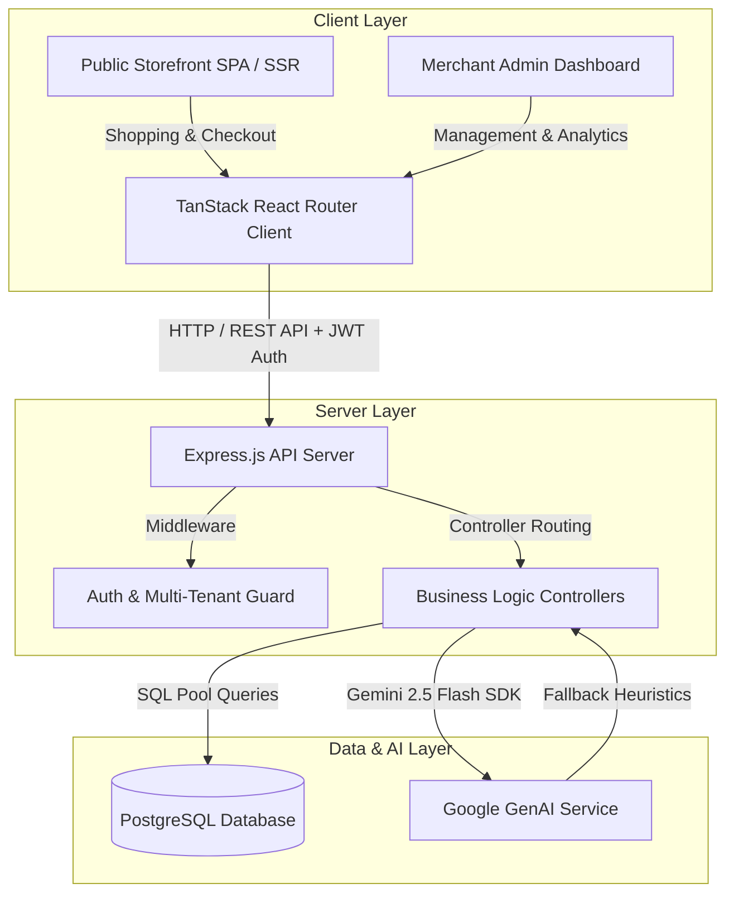
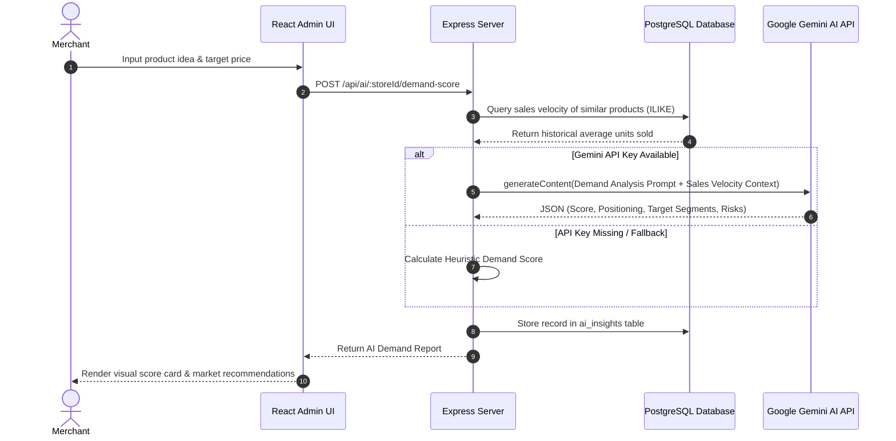

# 🚀 SmartStore AI — Autonomous E-Commerce & AI-Powered CRM System

**SmartStore AI** is a state-of-the-art, full-stack, multi-tenant e-commerce platform and AI-driven Customer Relationship Management (CRM) suite. Built on the **PERN** stack (PostgreSQL, Express, React, Node.js) paired with **TanStack Start**, **Vite**, **Tailwind CSS v4**, and **Google Gemini AI (2.5 Flash)**, SmartStore AI equips modern merchants with automated business intelligence, customer segmentation, AI demand scoring, automated email campaign generation, and domain-bounded AI assistant capabilities.

---

## 📑 Table of Contents

1. [System Overview & Architecture](#-system-overview--architecture)
2. [Technology Stack](#-technology-stack)
3. [Key Features & Modules](#-key-features--modules)
   - [Merchant Admin Dashboard](#1-merchant-admin-dashboard)
   - [AI Engine & Intelligence](#2-ai-engine--intelligence)
   - [CRM & Customer Pipeline](#3-crm--customer-pipeline)
   - [Public Customer Storefront](#4-public-customer-storefront)
   - [Email Marketing & Campaigns](#5-email-marketing--campaigns)
   - [Inventory & Product Management](#6-inventory--product-management)
   - [Discounts & Coupon Engine](#7-discounts--coupon-engine)
   - [Team Roles & Multi-Tenancy](#8-team-roles--multi-tenancy)
4. [Database Schema & Data Architecture](#-database-schema--data-architecture)
5. [System Design & Data Flow](#-system-design--data-flow)
6. [API Endpoints Reference](#-api-endpoints-reference)
7. [Installation & Getting Started](#-installation--getting-started)
8. [Environment Variables](#-environment-variables)
9. [AI Safety & Domain Guardrails](#-ai-safety--domain-guardrails)

---

## 🏗️ System Overview & Architecture

SmartStore AI connects dynamic e-commerce storefronts directly to a powerful back-office merchant ecosystem powered by generative AI. The platform is designed with a micro-modular architecture consisting of three core pillars:



---

## 🛠️ Technology Stack

### **Frontend Framework & UI**
- **Core**: React 19, TypeScript
- **Routing & SSR**: [TanStack Start](https://tanstack.com/start) & [TanStack React Router](https://tanstack.com/router)
- **Build Tool**: Vite
- **Styling**: Tailwind CSS v4, `tw-animate-css`, Glassmorphism design tokens
- **UI Components**: Radix UI Primitives (Accordion, Alert Dialog, Aspect Ratio, Avatar, Checkbox, Dialog, Dropdown, Navigation Menu, Popover, Select, Tabs, Tooltip) & Shadcn UI architecture
- **Data Fetching & State**: TanStack React Query (`@tanstack/react-query`), Axios
- **Form Handling & Validation**: React Hook Form, Zod schema validation
- **Data Visualization**: Recharts (interactive revenue, sales, customer analytics charts)
- **Icons & Notifications**: Lucide React, Sonner toast notifications

### **Backend Framework & Services**
- **Runtime & Server**: Node.js, Express.js (v5)
- **Database Client**: `pg` (PostgreSQL Connection Pooling)
- **Authentication & Security**: JSON Web Tokens (JWT), HTTP-Only Cookie Parser, Bcryptjs password hashing, Express Validator
- **File Uploads**: Multer (product images, store logo uploads)
- **Email Dispatch**: Nodemailer (transactional emails, campaign broadcasts)

### **AI Engine**
- **SDK**: `@google/genai` (Google GenAI Node.js SDK)
- **Model**: `gemini-2.5-flash` (with automated static/heuristic fallback mechanisms when API key is unconfigured)

---

## ✨ Key Features & Modules

### 1. Merchant Admin Dashboard
- **Real-Time KPIs**: Track Revenue, Total Orders, Average Order Value (AOV), Total Customers, Low Stock Alerts, and Active CRM Deals.
- **Sales Analytics**: Interactive revenue graphs using Recharts with multi-period breakdowns (Daily, Weekly, Monthly).
- **Recent Activity Feed**: Real-time audit log of customer orders, status changes, and deal movements.

### 2. AI Engine & Intelligence
- **Domain-Bounded AI Chatbot**: Embedded store assistant with strict contextual guardrails (`AiService.isInScope`). Restricts output strictly to store management, product positioning, marketing strategy, and CRM actions.
- **Customer Behavioral Insights**: Automated behavioral profile generation analyzing spend history, purchase frequency, and segment classification (`VIP`, `Active`, `At Risk`, `Churned`). Recommends personalized next actions, subject lines, and email bodies.
- **Product Demand Scoring**: Evaluate new product ideas prior to inventory launch. Combines database historical velocity heuristics with Gemini AI market analysis to generate:
  - Demand Score (0–100)
  - Target Pricing Recommendations
  - Target Customer Segments & Positioning Strategy
  - Risk & Entry Barrier Analysis

### 3. CRM & Customer Pipeline
- **Kanban Deal Pipeline**: Drag-and-drop sales pipeline stages (`lead`, `contacted`, `qualified`, `proposal`, `won`, `lost`).
- **Customer Segmentation**: Automatic categorization into actionable customer cohorts.
- **Deal Redemption & Coupon Issuance**: Convert qualified or won deals into unique promotional discount codes sent directly to customer profiles.
- **Detailed Customer Profiles**: Complete purchase history, total spend, average order value, note history, and AI recommendations.

### 4. Public Customer Storefront
- **Dynamic Storefront Routing**: Multi-tenant storefronts generated dynamically under `/shop/$slug`.
- **Product Discovery**: Category trees, live search, price filters, tag badges, stock status indicators.
- **Deals Page**: Dedicated promo hub displaying active store discounts and sales (`/shop/$slug/deals`).
- **Cart & Checkout Engine**: Seamless multi-item cart management, tax calculation, shipping selection, and instant order placement (`/shop/$slug/checkout`).
- **Order Tracking System**: Public order tracking page (`/shop/$slug/track`) by order number and phone/email lookup.

### 5. Email Marketing & Campaigns
- **AI Campaign Generator**: Generate subject lines, target segments, and responsive HTML email copy with personalized placeholders (`{{name}}`) from simple prompt descriptions.
- **Segmented Audience Dispatch**: Send targeted campaigns to specific cohorts (`vip`, `at_risk`, `new`, etc.) or all store customers.
- **Campaign Analytics**: Track delivery status, sent timestamp, target recipient count, and subject line variations.

### 6. Inventory & Product Management
- **Product Catalog**: Rich product listings with SKU, pricing, cost price, inventory stock counts, description, image gallery, category mapping, and active/draft status.
- **Inventory Adjustments**: Audit log tracking stock additions, damage write-offs, sales deductions, and manual reconciliations.
- **Low Stock Guard**: Automated badge highlights and dashboard warnings when inventory drops below safety thresholds.
- **Customer Product Reviews**: Public review submission, star rating system, and merchant approval/moderation controls.

### 7. Discounts & Coupon Engine
- **Flexible Rules**: Percentage discounts (`%`) or Fixed Amount (`$`) reductions.
- **Usage Controls**: Minimum order subtotal limits, maximum total usages, start and expiration timestamps.
- **Real-Time Validation**: Instant cart validation API verifying promo active state, date validity, and spending thresholds.

### 8. Team Roles & Multi-Tenancy
- **Multi-Tenant Architecture**: Multi-store isolation. All database tables strictly scoped by `store_id`.
- **Role-Based Access Control (RBAC)**:
  - **Owner**: Full access to store settings, financial reports, team management, AI features, and deletion privileges.
  - **Manager**: Products, inventory, orders, customer CRM, campaigns, and discounts.
  - **Staff**: Order fulfillment, customer viewing, and inventory inspection.

---

## 🗄️ Database Schema & Data Architecture

SmartStore AI utilizes a relational PostgreSQL database schema optimized for multi-tenancy and high query performance:

```
                            ┌──────────────┐
                            │    users     │
                            └──────┬───────┘
                                   │ 1:N
                            ┌──────┴───────┐
                            │  user_roles  │
                            └──────┬───────┘
                                   │ N:1
                            ┌──────┴───────┐
                            │    stores    │
                            └──────┬───────┘
      ┌────────────────────────────┼────────────────────────────┐
      │ 1:N                        │ 1:N                        │ 1:N
┌─────┴──────┐              ┌──────┴──────┐              ┌──────┴──────┐
│ categories │              │  products   │              │  customers  │
└─────┬──────┘              └──────┬──────┘              └──────┬──────┘
      │ 1:N                        │ 1:N                        │ 1:N
┌─────┴──────┐              ┌──────┴──────┐              ┌──────┴──────┐
│  products  │              │ order_items │              │    orders   │
└────────────┘              └──────┬──────┘              └─────────────┘
                                   │ N:1
                            ┌──────┴───────┐
                            │    orders    │
                            └──────────────┘
```

### Core Database Tables:
- `users`: User identity, hashed passwords (`bcrypt`), global superadmin state.
- `stores`: Store details, custom URL slug, currency, tax rates, contact email, branding logo.
- `user_roles`: Multi-tenant ownership & staff access (`owner`, `manager`, `staff`).
- `categories`: Hierarchical category trees per store.
- `products`: Product SKUs, titles, descriptions, pricing, cost, stock levels, images, categories.
- `inventory_adjustments`: Historical inventory logs with reasons (`restock`, `sale`, `damage`, `correction`).
- `customers`: Customer directory, total spend, order count metrics, phone, address, segment (`new`, `active`, `vip`, `at_risk`, `churned`).
- `orders` & `order_items`: Order status (`pending`, `processing`, `shipped`, `delivered`, `cancelled`), line items, payment status, subtotal, tax, discount amount, grand total.
- `crm_deals`: Pipeline deals with monetary value, stage, probability percentage, assigned customer, converted coupon ID.
- `email_campaigns`: AI or merchant created email broadcasts, HTML template, segment, sent counts.
- `discount_codes`: Promo codes, discount types (`percentage`/`fixed`), values, minimum spend, expiry.
- `product_reviews`: Star ratings, text review, status (`pending`, `approved`, `rejected`).
- `ai_insights`: Cached AI recommendations, demand evaluation scores, customer behavioral reports.

---

## 🔄 System Design & Data Flow

### **1. AI-Driven Demand Analysis Sequence**



---

## 🔌 API Endpoints Reference

### **Authentication & Public Routes**
| Method | Endpoint | Description |
| :--- | :--- | :--- |
| `POST` | `/api/auth/register` | Register new merchant user account |
| `POST` | `/api/auth/login` | Authenticate user & issue HTTP-Only JWT |
| `POST` | `/api/auth/logout` | Clear auth token cookie |
| `GET` | `/api/auth/me` | Fetch current authenticated user session |
| `GET` | `/api/public/store/:slug` | Fetch store public details by slug |
| `GET` | `/api/public/products/:slug` | Fetch public store product catalog |
| `POST` | `/api/public/orders/:slug` | Place public customer order |
| `GET` | `/api/public/orders/:slug/track` | Track order by order number |

### **Store & Admin Operations (`:storeId` scoped)**
| Method | Endpoint | Description |
| :--- | :--- | :--- |
| `GET` | `/api/products/:storeId` | List store products with pagination & search |
| `POST` | `/api/products/:storeId` | Create new product |
| `PUT` | `/api/products/:storeId/:id` | Update product details |
| `DELETE` | `/api/products/:storeId/:id` | Soft delete or purge product |
| `GET` | `/api/orders/:storeId` | List store orders & filter by status |
| `PATCH` | `/api/orders/:storeId/:id/status` | Update order fulfillment status |
| `GET` | `/api/customers/:storeId` | List customer directory with segment metrics |
| `GET` | `/api/crm/:storeId/deals` | Get CRM pipeline stages & deals |
| `POST` | `/api/crm/:storeId/deals` | Create CRM pipeline deal |
| `PATCH` | `/api/crm/:storeId/deals/:id/stage` | Update deal stage |
| `POST` | `/api/crm/:storeId/deals/:id/redeem` | Redeem deal and generate customer coupon |

### **AI Services (`/api/ai/:storeId`)**
| Method | Endpoint | Description |
| :--- | :--- | :--- |
| `POST` | `/api/ai/:storeId/chat` | Contextual AI chatbot assistant query |
| `GET` | `/api/ai/:storeId/customer-insight/:customerId` | Generate AI customer behavioral analysis |
| `POST` | `/api/ai/:storeId/demand-score` | Perform AI product idea demand scoring |
| `POST` | `/api/ai/:storeId/generate-campaign` | Draft complete AI email marketing campaign |
| `GET` | `/api/ai/:storeId/status` | Check Gemini API connection status |

---

## ⚡ Installation & Getting Started

### **Prerequisites**
- **Node.js**: `v18.x` or `v20.x` or higher
- **PostgreSQL**: `v14.x` or higher running locally or via cloud host (e.g. Supabase, Neon, Render)
- **Package Manager**: `npm` or `bun`

---

### **1. Clone & Workspace Setup**
```bash
git clone https://github.com/HaniTermos/CRM_SMART_AI_SYSTEM.git
cd CRM_SMART_AI_SYSTEM
```

---

### **2. Backend Setup & Configuration**
Navigate to the backend directory and install dependencies:
```bash
cd backend
npm install
```

Create a `.env` file inside the `backend/` directory:
```env
PORT=5000
NODE_ENV=development
FRONTEND_URL=http://localhost:5173

# Database Connection
DB_HOST=localhost
DB_PORT=5432
DB_NAME=smartstore_ai
DB_USER=postgres
DB_PASSWORD=your_password

# Authentication & Security
JWT_SECRET=super_secret_jwt_key_change_me
COOKIE_SECRET=super_secret_cookie_key

# Google Gemini AI Integration
GOOGLE_API_KEY=your_gemini_api_key
GEMINI_MODEL=gemini-2.5-flash

# Email Dispatch (Optional)
SMTP_HOST=smtp.gmail.com
SMTP_PORT=587
SMTP_USER=your_email@gmail.com
SMTP_PASS=your_app_password
```

Run Database Migrations & Initial Data Seeding:
```bash
# Execute schema migrations
npm run migrate

# (Optional) Seed demo store, products, customers, and orders
npm run seed
```

Start the Backend Development Server:
```bash
npm run dev
```
*The backend API will run on `http://localhost:5000`.*

---

### **3. Frontend Setup**
Open a new terminal window in the root directory:
```bash
# Install frontend dependencies
npm install

# Start Vite dev server
npm run dev
```
*The frontend application will be available at `http://localhost:5173`.*

---

## 🛡️ AI Safety & Domain Guardrails

To prevent hallucination, prompt injection, or out-of-scope off-topic responses, SmartStore AI implements a **Two-Tier AI Guardrail Architecture**:

1. **Keyword Scope Classifier (`AiService.isInScope`)**:
   - Analyzes incoming queries against mandatory e-commerce domain keywords (e.g., *products, inventory, CRM, campaigns, revenue, analytics, customers, pricing*).
   - Immediately intercepts off-topic requests (e.g., general coding questions, academic essays, recipes, travel advice) without invoking external LLM API calls, preserving API quota and ensuring brand alignment.
2. **Context-Aware System Prompts (`AiService.buildSystemPrompt`)**:
   - Dynamically injects context based on the user's current screen (`campaigns`, `demand`, `reports`, `customers`, `crm`, `products`).
   - Restricts assistant output to actionable, e-commerce-specific recommendations.

---

## 📄 License & Credits

Built with ❤️ by **Hani Termos** as a next-generation AI-powered e-commerce CRM platform.
